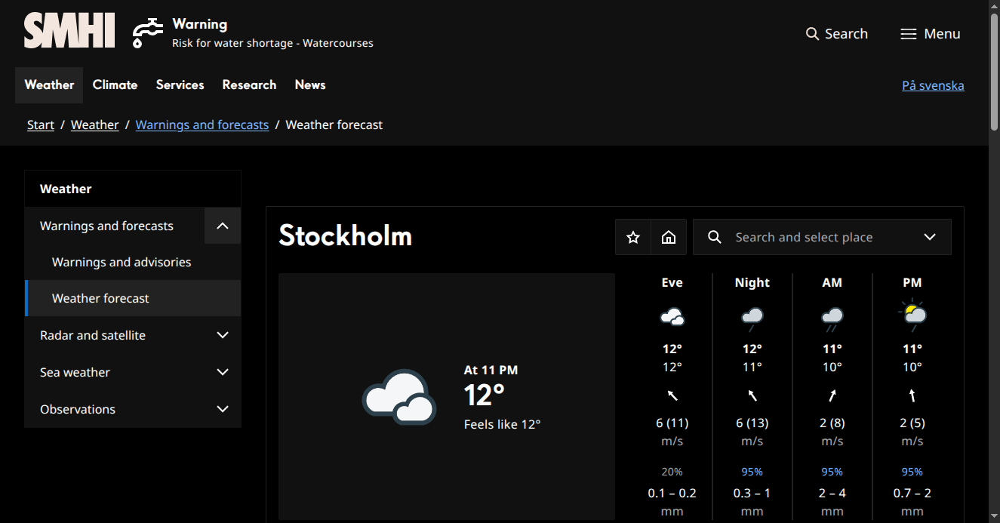

# SMHI Dark

[Install](https://raw.githubusercontent.com/aruncveli/userstyles/refs/heads/main/sites/smhi/smhi.user.css)

Dark theme for SMHI's
[ten day forecast](https://www.smhi.se/en/weather/warnings-and-forecasts/weather-forecast).
[SMHI](https://en.wikipedia.org/wiki/Swedish_Meteorological_and_Hydrological_Institute) is the
Swedish government agency for weather forecasts.

The theme covers the forecast table, map labels, and diagrams, reusing SMHI's native theme tokens
where possible. Selected weather symbols use embedded SVG replacements to brighten rain and sun rays
without recoloring clouds. These replacements target specific symbol variants, not dates; the
diagram's embedded SVG weather images are not covered by the HTML image replacements.

